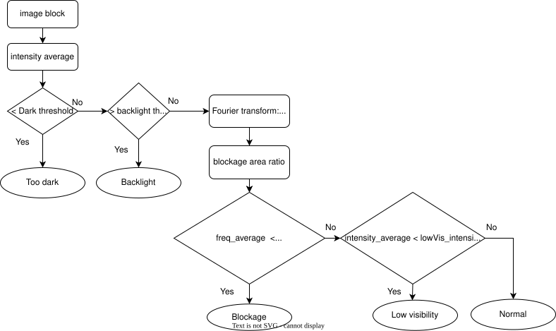
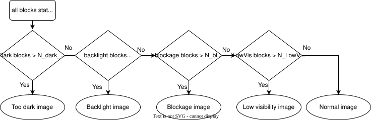

# image_diagnostics

## Purpose

The `image_diagnostics` is a node that check the status of the input raw image.

## Inner-workings / Algorithms

Below figure shows the flowchart of image diagnostics node. Each image is divided into small blocks for block state assessment.

Each small image block state is assessed as below figure.

After all image's blocks state are evaluated, the whole image status is summarized as below.

## Inputs / Outputs

### Input

| Name              | Type                      | Description |
| ----------------- | ------------------------- | ----------- |
| `input/raw_image` | `sensor_msgs::msg::Image` | raw image   |

### Output

| Name                                              | Type                                    | Description                           |
| ------------------------------------------------- | --------------------------------------- | ------------------------------------- |
| `image_diag/debug/<hardware_id>/gray_image`       | `sensor_msgs::msg::Image`               | gray image                            |
| `image_diag/debug/<hardware_id>/dft_image`        | `sensor_msgs::msg::Image`               | discrete Fourier transformation image |
| `image_diag/debug/<hardware_id>/diag_block_image` | `sensor_msgs::msg::Image`               | each block state colorization         |
| `/diagnostics`                                    | `diagnostic_msgs::msg::DiagnosticArray` | diagnostics                           |

The node publishes the `image_diag/debug/` topics only when `debug` is `true`.

## Parameters

| Name                                    | Type    | Default | Description                                                                                                       |
| --------------------------------------- | ------- | ------- | ----------------------------------------------------------------------------------------------------------------- |
| `hardware_id`                           | string  | none    | Camera ID for the diagnostics and the debug topic names. The launch file sets it from the `hardware_id` argument. |
| `debug`                                 | boolean | `false` | Whether to enable debug mode. If true, the node will publish debug images for visualization and analysis.         |
| `image_resize_height`                   | integer | `480`   | Target height to resize the input image before block analysis. Width is scaled proportionally.                    |
| `consecutive_error_frame_threshold`     | integer | `3`     | Number of consecutive frames with errors before triggering an error status.                                       |
| `num_blocks_horizontal`                 | integer | `5`     | Number of horizontal divisions to split the image into for diagnostics.                                           |
| `num_blocks_vertical`                   | integer | `5`     | Number of vertical divisions to split the image into for diagnostics.                                             |
| `blockage_region_error_threshold`       | integer | `5`     | Number of blockage blocks above which an error is issued.                                                         |
| `blockage_ratio_threshold`              | number  | `0.9`   | Ratio of dark pixels in a block above which it is considered blocked.                                             |
| `blockage_intensity_threshold`          | integer | `10`    | Pixel intensity threshold for binary image conversion during blockage detection.                                  |
| `blockage_frequency_ratio_threshold`    | number  | `0.3`   | Average frequency magnitude below which a block is considered blocked due to lack of detail.                      |
| `shadow_region_error_threshold`         | integer | `20`    | Number of shadowed (dark) blocks above which an error is issued.                                                  |
| `shadow_intensity_threshold`            | integer | `10`    | Pixel intensity below which a block is considered dark or shadowed.                                               |
| `highlight_region_error_threshold`      | integer | `3`     | Number of highlighted (overexposed) blocks above which an error is issued.                                        |
| `highlight_intensity_threshold`         | integer | `230`   | Pixel intensity above which a block is considered highlight clipping.                                             |
| `low_visibility_region_error_threshold` | integer | `4`     | Number of low visibility (blurred or foggy) blocks above which an error is issued.                                |
| `low_visibility_frequency_threshold`    | number  | `4.5`   | Average frequency magnitude below which a block is considered low visibility.                                     |

The [parameter schema](schema/image_diagnostics_node.schema.json) and the [parameter file](config/image_diagnostics_node.param.yaml) define these defaults, except `hardware_id`.

## Assumptions / Known limits

- This is proof of concept for image diagnostics and the algorithms still under further improvement.

## (Optional) Error detection and handling

## (Optional) Performance characterization

## (Optional) References/External links

## (Optional) Future extensions / Unimplemented parts

- Consider more specific image distortion/occlusion type, for instance raindrop or dust.

- Consider degraded visibility under fog or rain condition from optical point of view
